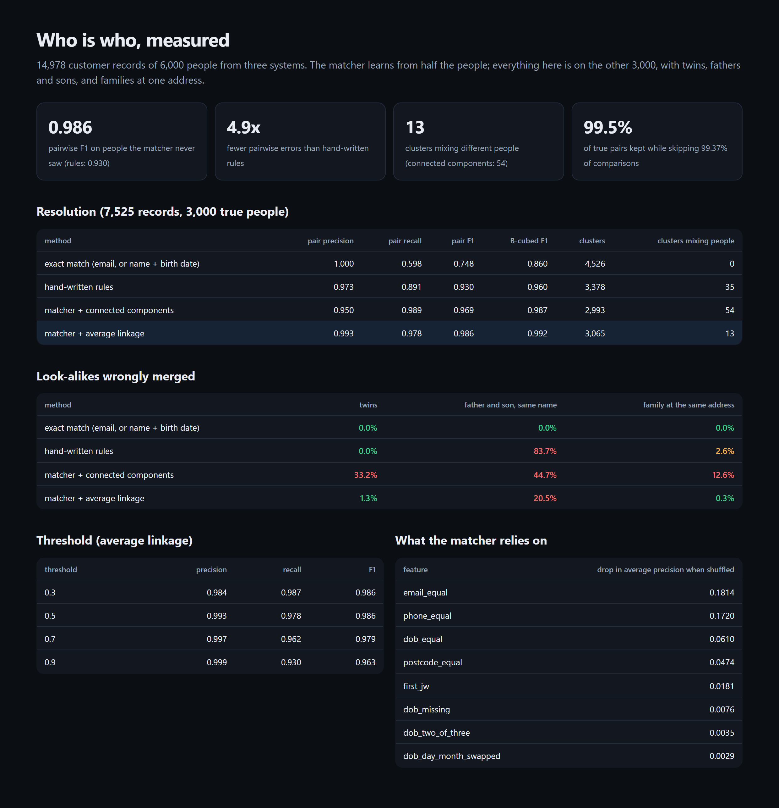

# Entity Resolution

Working out which customer records belong to the same person, and measuring how well it's done.
The pipeline blocks on seven keys to avoid comparing everything with everything. A learned matcher
handles nicknames, typos, swapped names and dates, moves and new emails. Clustering then refuses to
chain different people together. It is scored with pairwise and B-cubed F1 against exact-match and
hand-written-rule baselines, on people the matcher never saw.

[](https://github.com/codeROCK-IZZY/entity-resolution/actions/workflows/ci.yml)



## Results

From `resolve evaluate` (14,978 records of 6,000 people from three systems; the matcher is trained on
half the people and everything below is on the other half; [full report](eval/reports/evaluation.md)):

| method | pairwise precision | pairwise recall | pairwise F1 | B-cubed F1 | clusters mixing people |
|---|---:|---:|---:|---:|---:|
| exact match (email, or name + birth date) | 1.000 | 0.598 | 0.748 | 0.860 | 0 |
| hand-written rules | 0.973 | 0.891 | 0.930 | 0.960 | 35 |
| matcher + connected components | 0.950 | 0.989 | 0.969 | 0.987 | 54 |
| **matcher + average linkage** | **0.993** | **0.978** | **0.986** | **0.992** | **13** |

- **4.9× fewer pairwise errors** than hand-written rules, which also merge 84% of fathers and sons
  who share a name.
- **Blocking** keeps 99.5% of true pairs while skipping 99.37% of the 28 million possible comparisons.
- **Clustering matters as much as matching.** With the same matcher, connected components merge a
  third of twin pairs. Average linkage merges 1.3%
  ([ADR 2](docs/adr/0002-average-linkage-not-connected-components.md)).
- **What still goes wrong:** a son with his father's name and address is wrongly merged in 20.5% of
  pairs, because the birth date is the only reliable difference and it's missing from a fifth of
  records. This is reported, not hidden.

## How it works

- `data.py`: people and their records across CRM, billing and support systems. Records carry
  nicknames, typos, initials, changed or swapped names, swapped or mistyped birth dates, new or
  reformatted emails and phones, and abbreviated or new addresses. Look-alikes include very common
  names, twins, fathers and sons with the same name, and families at one address.
- `features.py`: normalisation (nickname to full name, email dots and `+tags`, phone formats, street
  abbreviations), Jaro-Winkler, Soundex, and 22 pair features, including how rare a shared name is.
- `pipeline.py`: multi-key blocking with a block-size cap, a gradient-boosted matcher, connected
  components, average-linkage agglomeration, and the two baselines
  ([ADR 1](docs/adr/0001-block-then-learn.md)).
- `metrics.py`: pairwise and B-cubed precision, recall and F1, and cluster statistics.

## Run it

```bash
python -m venv .venv && . .venv/bin/activate
pip install -e ".[dev]"
pytest
resolve evaluate --gate         # ~1 min; writes eval/reports/{evaluation.md,evaluation.json,report.html}
resolve compare '{"first": "Bob", "last": "Smith", "dob": "1980-01-02"}' \
                '{"first": "Robert", "last": "Smyth", "dob": "1980-02-01"}'   # why two records look alike
```

| check | where |
|---|---|
| 9 tests (including one where connected components chain three records and average linkage refuses), strict mypy, ruff | `tests/`, `src/` |
| the evaluation as a CI gate (blocking recall, half the errors of each baseline, fewer mixed clusters, twins kept apart) | `.github/workflows/ci.yml` |

See [known limitations](docs/known-limitations.md).

## License

MIT
